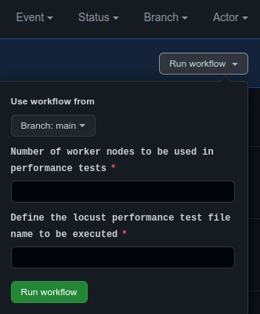
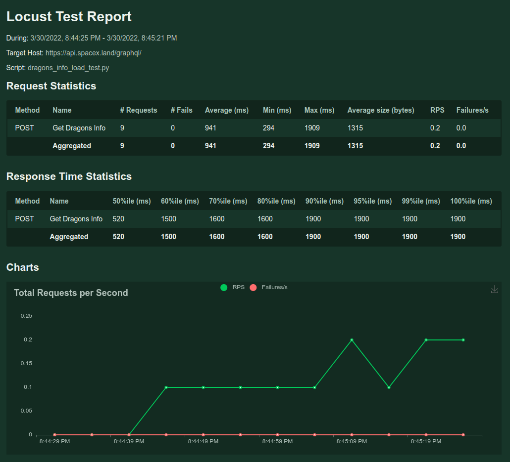

# Baseline Performance Tests with Locust, Docker Compose and Github-Actions
Locust is a python based load testing framework. Documentation can be found here: [Documentation](https://docs.locust.io/en/stable/index.html)

The scenarios use the [Countries GraphQL API](https://github.com/trevorblades/countries):

* `country_info_load_test.py`: fetches Brazil with its continent and languages.
* `countries_info_load_test.py`: fetches South American countries with their continents and languages.

The public API is shared infrastructure; permission to load-test it has not been established. Obtain permission and respect its limits before running load tests against it, or set `HOST` to a self-hosted compatible API. External availability, caching and network latency can affect the results.

## Installation
Since we are working with a Docker Compose setup, you just need to have Docker with the Compose plugin installed on your machine.

## Run distributed tests in headless mode - Docker Compose
You can run distributed tests with Docker Compose and easily scale more workers: [Distributed tests](https://docs.locust.io/en/stable/running-locust-docker.html)
1. Set `HOST` and `LOCUST_LOCUSTFILE` in `.env` for your test run. The defaults select the public Countries API and the country-detail scenario.
2. Run `docker compose up --scale worker=4` with as many workers as you want
3. After your test, run `docker compose down` or just press `Ctrl + C` if you are running Docker Compose in interactive mode

To run the scenario tests against a local stub without contacting the public API:

```
docker compose run --rm -w /mnt/locust --entrypoint python master -m unittest discover -s tests -v
```

## Running directly using Github Actions

Using Github Actions, it is possible to run the performance tests directly from the repository. The pipeline is configured to receive some parameters, including selection of test script and number of workers, what makes it flexible for different test runs.

Manual runs use the selected scenario and worker count. Push, pull-request and scheduled runs are skipped by default; set the repository variable `ENABLE_AUTOMATED_LOAD_TESTS` to `true` to opt in after ensuring the target permits automated load testing. Automated runs use `country_info_load_test.py` and four workers.



## Project Structure
* `__init__.py`: Here we have the setup and teardown for our tests. You can insert here anything that needs to be executed at the beginning and at the end of the test execution
* `.env`: This is the general config file. It specifies the host and default Locust file.
* `data/*.py`: We separated the query and filter values into separated test data files, in order to make the tests more readable and maintanable
* `testConfig/*.py`: This folder contains the ramp and KPI configs for each specific performance test
* `common/*.py`: Here we have shared functions and values that are applied in multiple test files
* `kpi_checker.py`: This file contains auxiliary methods necessary for the automated KPI validation
* `*_load_test.py`: These are our performance test files. They include our requests and other additional information
* `load_test_custom_shape.py`: This is the custom ramp configuration, that is imported and used by the different load tests

## RPS checks
We are using a config that enable us to provide a few KPIs goals for a tests excution through environment variables. Right now, we have the possibility to use 5 KPIs:
* RPS
* Maximum fail ratio
* 90% response time percentile
* 95% response time percentile
* 99% response time percentile

Edit the KPI goals in the selected scenario's `testConfig/*_test_config.py` file.

When the results don't achieve the KPI goals, we have messages returned in the terminal and a different exit code (code 3) of the script, that can be used to integrate with other tools, like for example Jenkins:

```
master_1  | [2021-10-07 21:35:01,009] dc53ec78188f/INFO/root: CHECK FAILED: 90% percentile was 300.0 ms (threshold 200.0 ms)
master_1  | [2021-10-07 21:35:01,009] dc53ec78188f/INFO/root: CHECK SUCCESSFUL: 95% percentile was 360.0 ms (threshold 500.0) ms
master_1  | [2021-10-07 21:35:01,009] dc53ec78188f/INFO/root: CHECK SUCCESSFUL: 99% percentile was 910.0 ms (threshold 1000.0) ms
master_1  | [2021-10-07 21:35:01,010] dc53ec78188f/INFO/root: CHECK FAILED: total rps was 3.6 (threshold 10.0)
master_1  | [2021-10-07 21:35:01,010] dc53ec78188f/INFO/locust.main: Shutting down (exit code 3), bye.
```

If necessary, it is possible to also add more KPIs to be validated. We just need to get it from the metrics that locust provide us: [Locust_stats](https://github.com/locustio/locust/blob/master/locust/stats.py)

The KPIs validation is possible due to a locust plugin. You can get more info about that in this link: [Locust_plugins](https://github.com/SvenskaSpel/locust-plugins/blob/master/locust_plugins/__init__.py)

## Test Report

The test report is automatically generated after every test run. When running from Github Actions, it will be present in the archived artifacts.

